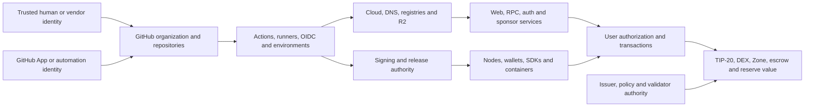

# Tempo Organizational Attack Surface

Snapshot time: **2026-08-21 16:58 UTC** \
Scope: Tempo-controlled public systems and public integration boundaries \
Perspective: external, read-only, public-information review

## How to read this document

This is the root map of Tempo's publicly observable attack surface. It is intended to remain current: mutable claims include an observation time, repository claims are pinned in the linked inventory, and unresolved private controls are called out instead of inferred.

“Complete” here means complete for assets discoverable from Tempo's public GitHub organization, official documentation, source references, certificate records, DNS, and bounded read-only requests on the snapshot date. It cannot enumerate private repositories, cloud projects, personnel, secret scopes, internal networks, incident systems, validator custody, or unpublished deployments.

This project prioritizes theft and durable financial control. Pure availability or vandalism paths are secondary unless they enable theft, deceptive authorization, concealment, or compromise of a more valuable boundary.

## Executive model

Tempo's highest-value attack surface is the composition of five planes:

1. **Value plane:** TIP-20 balances and issuer roles, DEX balances, Zone deposits, fee/sponsor funds, raffle escrow, reserves, and validator rewards.
2. **Identity and authorization plane:** root accounts, passkeys, delegated access keys, fee payers, policy administrators, release identities, GitHub Apps, cloud credentials, validator identities, and threshold signing shares.
3. **Control plane:** GitHub, Actions, branch/tag rules, CI environments, Cloudflare, Vercel, DNS, package registries, R2, container registries, and operational recovery.
4. **Distribution plane:** node binaries, containers, installers, wallet extensions, SDK packages, Ledger software, documentation, token lists, and contract-verification metadata.
5. **Data and interaction plane:** RPC, WebSocket, explorer, indexer, sponsor, authentication dialogs, contract verifier, snapshots, MPP services, and reconciliation data.

The dominant public-source threat pattern is not an unauthenticated Internet exploit. It is a compromised trusted identity or third party crossing from source control into secrets, deployments, signed releases, wallet authorization, or directly controlled funds.

## Crown jewels and conversion paths

| Asset or authority | Why it matters | Plausible conversion to theft | Publicly visible controls or evidence |
| --- | --- | --- | --- |
| User root keys, passkeys, and wallet access keys | Authorize transfers, approvals, scoped calls, and persistent delegated authority | Compromise a trusted wallet/auth origin or signed client, then obtain or misuse authorization | Accounts SDK, Tempo Auth, wallet CLI, Ledger app, Account Keychain source |
| TIP-20 issuer and TIP-403 policy roles | Can mint, burn, freeze, pause, or govern compliance depending on the role | Abuse a compromised administrative key to create, seize, redirect, or selectively permit value | Native-contract source and protocol specifications; deployed role ownership is not yet pinned |
| DEX and fee-conversion balances | Hold internal balances and determine exchange/fee settlement | Exploit accounting, privileged configuration, or price/liquidity assumptions to withdraw or redirect value | Native precompile source and green component test suites |
| Zone portal deposits and allowances | Move assets from Tempo into Zone escrow and confidential recipients | Use delegated contract authority or stale allowance in a way broader than the user expects | `zones`, Tempo Account Keychain, and private candidate C-003 |
| Fee-payer and application escrow keys | Sign sponsored transactions or hold application funds | Obtain a signing key through CI or application compromise and submit unauthorized payouts | `tempo-apps`, `tip.bot`, candidates C-002/C-005 |
| Release-signing roots and publication credentials | Establish trust in node and wallet artifacts | Publish a validly signed malicious update that reaches operators or wallet users | GPG, Sigstore, minisign, R2, GitHub Releases, GHCR and Docker Hub paths |
| GitHub/cloud/DNS administration | Controls the software and origins users trust | Alter code, workflows, deployments, domains, packages, or recovery paths | Public rulesets/environments are only a partial view; internal audit/MFA controls are unknown |
| Validator identities and BLS shares | Participate in permissioned consensus and finality | Compromise enough operational authority to authorize or conceal unsafe state, or exploit recovery | Official architecture is public; custody, quorum composition, and recovery controls are not |
| Reserve, bridge, and reconciliation claims | Influence backing, issuance, routing, and user confidence | Compromise an integration key or trusted data source to misroute funds or hide a deficit | `pathusd-reserves`, `bridgerton`, public APIs; underlying partner systems are out of scope |

## Organization and human trust

- GitHub organization: [`tempoxyz`](https://github.com/tempoxyz), verified by GitHub as controlling `tempo.xyz`.
- The public API exposed **15 public organization members** at the snapshot time. Public membership is voluntary and is not a roster of all employees, contractors, bots, outside collaborators, or privileged accounts.
- Relevant capability classes are repository writers, reviewers, release operators, GitHub App owners, cloud/DNS administrators, package maintainers, issuer/policy administrators, validator operators, support/recovery personnel, and vendor administrators.
- Public evidence does not reveal MFA strength, hardware-key enforcement, workstation management, employment status, least-privilege review, emergency-access procedures, or audit response. This analysis therefore models capabilities and trust boundaries, not named people.
- Several current candidates require a compromised same-repository writer/member rather than an outside fork author. That prerequisite is important but realistic for the project's insider and third-party-compromise threat model.

## Public source-control inventory

The GitHub API returned **68 public repositories** at `2026-08-21T16:12:50Z`: **52 non-forks**, **16 forks**, **15 archived repositories**, and **48 active non-fork repositories**. The complete set was mirrored with all reachable Git history under ignored `target/public-repos/`; no third-party submodule repositories were recursively added merely because a Tempo repository referenced them.

Across the current default branches, 52 repositories contain 446 workflow files; the 48 active non-forks account for 203 of those files across 34 repositories. Among those active non-forks, source flags show 30 repositories referencing a secrets context, 30 declaring some write permission, seven using `pull_request_target`, six using `issue_comment`, and Tempo/Zones referencing self-hosted runners. These are review leads, not vulnerability claims. Twenty-two repositories carry their own `SECURITY.md`, and the organization-level `.github` repository supplies a shared policy. GitHub reported 20 repositories with a latest stable release and four with Pages enabled. These counts describe public configuration, not the number of production services.

The authoritative pinned manifest is [`recon/2026-08-21-public-repositories.csv`](recon/2026-08-21-public-repositories.csv). Repository grouping below is functional and does not prove production use. Public governance metadata was sampled for 18 financially sensitive repositories: 17 default branches appeared protected, `txgen` appeared unprotected, 40 environments were visible, and only `tempo-go/releases` exposed required reviewers. Private organization policy may add controls that the public API cannot show.

### Protocol, contracts, and transaction tooling — 6

`tempo`, `zones`, `tempo-std`, `tempo-foundry` (archived), `chains` (archived fork), `txgen`.

These repositories define or test the node, native precompiles/contracts, transaction helpers, Zone runtime, chain data, and transaction generation. A defect or malicious change can affect consensus inputs, authorization, fee accounting, asset state, or developer assumptions.

### Applications, wallets, data, and operations — 14

`Tempo-Integrations`, `accounts`, `agents-tempo-xyz`, `bridgerton`, `cf-template-proxy`, `ledger-app-tempo`, `pathusd-reserves`, `rpc-tester`, `tempo-apps`, `tempo-support`, `tidx`, `tip.bot`, `wallet-cli`, `wallet-rs`.

This group contains user authorization, locally stored keys, hosted workers, explorer/indexer data, transaction sponsorship, hardware-wallet display, reserves/bridge tooling, support surfaces, and application-held funds.

### SDK, MPP, agent, and integration ecosystem — 23

`accounts-sdk-duplicate-iframe-repro` (archived), `appkit-wagmi-tempo-wallet`, `frenchy`, `hermes-mpp`, `incur-rs`, `mpp`, `mpp-discovery-mcp` (archived), `mpp-e2b`, `mpp-go`, `mpp-irl`, `mpp-proxy-cf`, `mpp-rs`, `mpp-specs`, `mpp-tools`, `openclaw-mpp`, `pympp`, `pytempo`, `schelk`, `skills`, `tempo-go`, `tempo-maybe-pay`, `tempo-ts` (archived), `ungoogled-chromium-mpp` (fork).

These expand Tempo authorization and payments into browsers, agents, HTTP 402 payment flows, multiple language ecosystems, and third-party integrations. Their main risk is confused or over-broad authorization, dependency/package compromise, insecure defaults, and divergent implementations of the same wire format.

### Organization, CI, release, documentation, and research tooling — 15

`.github`, `benchmarkoor-replay`, `changelogs`, `ci`, `docs`, `examples`, `execution-payloads-benchmarks` (fork), `export-tempo`, `gh-actions`, `lints`, `metrics-derive`, `pg_clickhouse` (fork), `revm-inspectors` (fork), `scfuzzbench` (fork), `tempo-evals`.

These repositories are indirect but high-leverage. Shared actions, release automation, templates, generated changelogs, documentation, benchmark runners, and organization defaults can influence many downstream repositories or teach users to install software and authorize accounts.

### Archived upstream/toolchain forks — 10

`foundry`, `foundry-1`, `foundry-2`, `foundry-tempo-pr`, `reth`, `reth-1`, `reth-2`, `reth-3`, `reth-4`, `viem`.

Archived does not mean irrelevant. These histories may remain pinned in lockfiles, CI, releases, documentation, or downstream caches. Their residual dependency use must be proven before exclusion.

## GitHub, CI, and release control plane

Publicly observable surfaces include:

- **52 of the 68** mirrored default branches contain **446 workflow files**, so Actions policy and shared automation are organization-wide rather than confined to the core node;
- repository writers, collaborators, organization members, reviewers, CODEOWNERS, branch rules, rulesets, tags, deploy keys, GitHub Apps, and default organization workflow policy;
- `pull_request`, `push`, `workflow_dispatch`, release/tag, scheduled, comment, and reusable-workflow triggers;
- GitHub-hosted and self-hosted runners, repository-local actions, dependency installation hooks, PR-generated artifacts, and executable resolution from the checkout;
- repository and environment secrets, GitHub App credentials, OIDC identity tokens, short-lived STS tokens, and `GITHUB_TOKEN` permissions;
- GitHub Releases, attestations, GHCR, Docker Hub, R2-hosted binaries, package registries, and signing keys.

Confirmed defensive controls include protected default/release branches in important repositories, pinned third-party actions in several reviewed workflows, fork-PR secret withholding, checks/reviews on protected branches, release checksums/signatures, and Sigstore attestations for Tempo node releases.

The current high-value gaps are compositional:

- branch review does not protect a secret-bearing job that executes same-repository PR code before merge;
- branch rules do not protect release tags unless independent tag rules or environments do so;
- an immutable third-party action remains unsafe if it resolves tooling from an unreviewed workspace after receiving a secret;
- one broad cloud or release credential can join otherwise separate applications into a common blast radius;
- a signed artifact is only as trustworthy as the workflow, tagged commit, signing identity, storage account, update metadata, and downstream version-selection logic together.

Public GitHub settings cannot reveal secret values/scopes, private rules, runner isolation, IP restrictions, audit alerts, internal approvals, or whether a credential has since rotated. Those remain explicit validation gates.

## Distribution and package surface

Known channels include:

- GitHub Releases for Tempo, wallet clients, SDKs, changelog/export tools, MPP implementations, and archived toolchains;
- at least 16 public GHCR container package names observed on the organization package page: `mpp-irl`, `pg_clickhouse`, `rpc-tester`, `stable-bench-base`, `tempo`, `tempo-bench`, `tempo-bench-base`, `tempo-localnet`, `tempo-sidecar`, `tempo-xtask`, `tempo-zone`, `tempo-zone-prover`, `tempo-zone-xtask`, `tidx`, `tsidp`, and `txgen`;
- Docker Hub publication by the Tempo tag workflow;
- R2/custom-domain delivery through `cli.tempo.xyz` and other binary hosts referenced in source;
- Rust/crates.io, npm, Python/PyPI, and Go module consumers;
- `curl | shell` installers, the Tempo launcher/updater, Wallet CLI extensions, and Ledger distribution.

Primary review questions are who can publish, whether a reviewed commit is bound to each artifact, whether tags and metadata are immutable, how clients select updates, whether signatures and manifests can be replaced together, and whether old/deprecated package names remain installable.

## Protocol and on-chain surface

### Networks and consensus

| Network | Read-only observation | Operational surface |
| --- | --- | --- |
| Tempo mainnet | `eth_chainId` returned `0x1079` (`4217`) from `https://rpc.tempo.xyz` on 2026-08-21 | Permissioned validator admission, Simplex consensus, node releases, chain spec/genesis, RPC, snapshots, upgrades and incident recovery |
| Moderato | `eth_chainId` returned `0xa5bf` (`42431`) from `https://rpc.moderato.tempo.xyz` on 2026-08-21 | Public test/faucet behavior, pre-mainnet feature exposure, SDK defaults, and deployment drift |
| Development/next-fork networks | Names and endpoints appear in source | Lower-assurance credentials and configuration can still become a bridge into shared cloud or CI accounts |

Official source describes Ed25519 validator identity keys, BLS12-381 threshold signing shares, periodic on-chain DKG, and currently permissioned active-set management. Public evidence does not establish current membership, key custody, share backup, rotation, quorum geography, or emergency-recovery practice.

### Execution and native financial primitives

- Tempo transaction type `0x76`: batching, passkey/P-256 authentication, delegated key authorization, fee sponsorship, scheduled calls, and parallel nonce keys.
- Account Keychain and signature verification: key types, call scopes, spending limits, expiry, revocation, and authorization-domain separation.
- TIP-20: transfers, allowances, memos, mint/burn/freeze/pause roles, rewards, and issuer authority.
- TIP-403: shared compliance policies and policy-administrator blast radius.
- Stablecoin DEX and fee conversion: deposits/internal balances, order matching, fees, withdrawals, AMM liquidity, and validator fee preferences.
- Payment-lane classification and reserved blockspace.
- Validator configuration, storage credits, nonces, receive-policy guards, fee manager, and virtual addresses.
- Zones: canonical runtime, bridge/portal escrow, encrypted recipients, withdrawals, proofs, Zone governance, and cross-system authorization.

The complete checked-in active suites were green at pinned revisions—1,088 Tempo precompile tests, 197 `tempo-revm` tests, 485 Zones tests, and 7 Zones symbolic tests—but green component tests do not prove deployment identity or cross-system safety. `tempo-std` had only three passing tests and zero executed coverage of its transaction helpers.

The exact mainnet release, genesis/chainspec relationship, activated TIP set, native deployments/bytecode, privileged role holders, and upgrade gates are still being pinned under T-002/T-004.

## Authorization, wallet, and user-signing surface

The authorization path spans more than a keypair:

1. an application or MPP client constructs an intent;
2. Accounts SDK, wallet CLI, Ledger, or another SDK serializes and displays it;
3. a passkey/root key or delegated access key authorizes it;
4. an optional fee payer or sponsor participates;
5. RPC/txpool validation, execution, native contracts, and indexers interpret the result;
6. wallet history, explorer, verifier, merchant, and reconciliation systems tell the user what happened.

Important ambiguity and compromise boundaries are WebAuthn origin/RP binding, embedded dialogs, postMessage transport, device-code flows, chain/domain separation, transaction simulation, batch contents, selector/argument scope, allowances versus delegated limits, nonce spaces, scheduled validity windows, fee-payer signatures, recovery/revocation, and cross-language serialization.

`auth.tempo.xyz` is especially sensitive because it currently serves a Tempo Auth application whose route manifest includes transaction signing and access-key authorization/revocation operations. `accounts.tempo.xyz` supplies SDK documentation and integration guidance. The wallet CLI keeps delegated private signing material locally and is extended/updated through Tempo's launcher. A compromise of any one frontend, SDK, release channel, RPC view, or sponsor does not automatically imply key theft, but the composition determines what the user actually sees and signs.

## Public web, API, and data plane

One ordinary unfollowed HTTPS request was made to each source-documented host below at approximately 16:15 UTC. Status proves only that a route answered; it does not establish ownership, source-to-deployment identity, origin security, or permission for intrusive testing.

| Host | Observed response | Apparent role and high-value boundary |
| --- | --- | --- |
| `tempo.xyz` | `200` HTML | Canonical brand, documentation entry, installers and social trust |
| `accounts.tempo.xyz` | `200` Markdown | Accounts SDK documentation and integration guidance |
| `auth.tempo.xyz` | `200` HTML, title `Tempo Auth`, Vercel | Wallet signing and access-key dialog origin; see C-001 timeline |
| `wallet.tempo.xyz` | `200` HTML | Wallet product/distribution entry |
| `keys.tempo.xyz` | `404` at `/` | WebAuthn/key-manager Worker; root response is not a health verdict |
| `sponsor.tempo.xyz` | `400` JSON at `/` | Mainnet transaction sponsorship/fee-payer API |
| `explore.tempo.xyz` | `200` HTML | Explorer, transaction display, wallet links and chain interpretation |
| `contracts.tempo.xyz` | `302` to `/docs` | Contract verification/source metadata |
| `indexer.tempo.xyz` | `404` at `/` | Structured chain data; root response is not a health verdict |
| `tokenlist.tempo.xyz` | `302` to `/docs` | Token metadata and user-facing asset identity |
| `rpc.tempo.xyz` | `400` JSON at GET `/`; JSON-RPC chain ID succeeded | Mainnet transaction submission and canonical read view |
| `docs.tempo.xyz` | `308` to `tempo.xyz/developers` | Legacy/canonical documentation routing |
| `mpp.tempo.xyz` | `200` text | Machine Payments Protocol web/service surface |
| `cli.tempo.xyz` | `404` HTML at `/` | Wallet extension manifests and binaries live at non-root paths |
| `snapshots.tempo.xyz` | `200` HTML | Node snapshot distribution and operator bootstrap |
| `app.tempo.xyz` | DNS lookup failed | Historical/source reference; not a confirmed current service |

Current non-archived default-branch source contains **96 distinct `tempo.xyz`-shaped host strings**: 38 current official-source references, 19 current MPP-integration references, 30 non-production or historical environment names, and nine fixtures or malformed strings. They are discovery candidates, not 96 production services. The complete source-only index is [`recon/2026-08-21-source-referenced-hosts.tsv`](recon/2026-08-21-source-referenced-hosts.tsv). Important additional families include Moderato/testnet/devnet RPC and explorers, faucet/sponsor variants, binary download hosts, MPP examples/services, preview account domains, and performance infrastructure. Their DNS, TLS, ownership, environment, and source-to-deployment mappings remain part of T-006.

## Data consistency and verification surface

Users and applications may rely on different views from the node RPC, `tidx`, Explorer, token list, contract verifier, wallet history, MPP merchant, and off-chain reconciliation systems. Security questions include:

- whether contradictory views are detected before signing, crediting, redeeming, or settling;
- whether untrusted ABI/source/token metadata can change transaction presentation;
- whether indexer lag/reorg assumptions can cause double credit or premature settlement;
- whether admin endpoints, SQL/query interfaces, snapshot metadata, or decoded calldata are separated from public reads;
- whether a compromised CDN/cache can substitute stale or attacker-controlled metadata.

## Cloud, SaaS, and third-party boundaries

| Boundary | Tempo-controlled side | Authority or data crossing the boundary | Scope limit |
| --- | --- | --- | --- |
| GitHub | Repositories, Actions, Apps, releases, packages | Source, review, CI identity, OIDC, secrets, tags, artifacts | Private organization controls are not visible |
| Cloudflare | Workers, routes, R2, DNS/CDN and API tokens | Production code, APIs, wallet binaries, secrets and traffic routing | Do not test unrelated Cloudflare infrastructure |
| Vercel | Website/docs/auth deployments and custom domains | Trusted `tempo.xyz` origins and deployment identity | Account/project ownership requires Tempo confirmation |
| Registries | GHCR, Docker Hub, npm, crates.io, PyPI and Go proxies | Installable code, mutable tags, dependency resolution and maintainer identity | Registry-account controls are not public |
| Bridge.xyz / Stripe | Bridge/card/reserve and wallet-backed payment integration | Customer, issuance, routing, KYC/card and reserve-related authority | Review only Tempo's integration boundary |
| Privy and other wallet/auth providers | Sponsor/auth integrations referenced in source | Authentication or fee-payer trust depending on deployment | Do not enumerate provider tenants beyond public Tempo config |
| Slack, Anthropic, AWS STS/OIDC | CI/release/support automation | Notifications, generated changelogs, temporary tokens and automation actions | Secret scopes and enterprise controls are unknown |
| Grafana Cloud / Pyroscope | Experimental node profiling and observability | Profile telemetry, service quota, and monitoring integrity; see OBS-002 | Public branch source does not establish token validity or scope |
| Reth, Commonware, Foundry, viem and language ecosystems | Upstream dependencies and forks | Consensus/execution/toolchain behavior and build inputs | Upstream projects are reviewed only where consumed by Tempo |
| Ledger | Hardware-wallet application and review/distribution | Transaction display, signing semantics and app provenance | Ledger's unrelated internal systems are out of scope |

## Prioritized intrusion-to-theft chains

| Foothold | Authority crossed | Theft-enabling primitive | Value target | Current evidence |
| --- | --- | --- | --- | --- |
| Compromised organization member or collaborator | Same-repository PR into preview/release CI | Obtain an application escrow/signing key or privileged cloud credential before review | Raffle escrow, sponsored transaction authority, users interacting with modified services | C-002, C-004, C-005, C-008 |
| Compromised repository writer, App, or deploy key | Unprotected release tag into artifact workflows | Publish official signed/mutable node or container artifacts | Node operators, infrastructure credentials, downstream services and user funds | C-006 |
| Compromised release workflow/cloud account | Signing plus R2/update metadata | Publish a wallet extension accepted by the Tempo launcher | Locally stored delegated wallet keys and their permitted balances | C-008 |
| Compromised delegated key | Scoped call into a contract with pre-existing root allowance | Spend through the contract outside the key's presented token limit | Root-account TIP-20 allowance and Zone-directed funds | C-003; deployment/user intent unresolved |
| Compromised Vercel/DNS project | Trusted authentication origin | Serve deceptive signing/auth flows or abuse an allowlisted origin | User credentials or authorization | C-001 historical anomaly; current site restored and ownership unresolved |
| Compromised issuer/policy/validator operator | On-chain or consensus administrative authority | Mint, freeze, redirect, admit, recover, or conceal depending on role | System or issuer-level payment assets | Privileged-by-design surface; deployed controls not yet pinned |
| Compromised RPC/indexer/verifier/token metadata service | User/application data trust | Present a misleading transaction, asset, source, confirmation, or settlement view | User authorizations and merchant/reconciliation credit | Threat hypothesis; no validated finding yet |
| Compromised reserve/bridge integration | Vendor credential/data boundary | Redirect settlement, misstate backing, or trigger incorrect issuance/redemption | Bridge/reserve funds and claims | Architecture mapping incomplete |

## Detection and recovery choke points

The most useful defensive telemetry would correlate:

- GitHub membership/role/App/deploy-key changes, same-repository PR creation, environment approvals, OIDC claims, secret reads, runner identity, tag creation, package/release publication, and audit-log export;
- Cloudflare/Vercel/DNS project changes, token use, Worker/R2 deployments, custom-domain bindings, route changes, and origin/certificate history;
- signing-key use, artifact hashes, provenance subjects, R2 object versioning, container tag movement, package-owner changes, and client update uptake;
- privileged on-chain role changes, new access keys/allowances, sponsor behavior, unusually broad batches, issuer/policy actions, DEX/Zone withdrawals, validator/DKG changes, and incident-recovery events;
- cross-view disagreement among RPC, indexer, explorer, verifier, token list, wallet, reserve, and settlement systems.

Recovery must assume a compromised identity may have created a second foothold. Rotating one token is insufficient if the attacker also changed a GitHub App, environment, OIDC policy, DNS project, package owner, signing key, update manifest, delegated on-chain key, or cloud service secret.

## Confirmed controls, limitations, and open gates

### Confirmed from public evidence

- A published vulnerability channel and security policy exist.
- Important repositories use reviews/checks on protected branches.
- Tempo node releases publish checksums, GPG signatures, and Sigstore provenance.
- Several actions and build dependencies are pinned to immutable revisions.
- Fork pull requests do not receive ordinary repository secrets under GitHub's documented model.
- Extensive component tests exist for native precompiles, EVM integration, and Zones.
- Mainnet and Moderato RPC endpoints answer with their documented chain IDs.

### Not established externally

- complete private repository and personnel inventory;
- exact mainnet release/genesis/hardfork/native bytecode and privileged roles;
- validator membership, threshold-share custody, backups, rotation and emergency procedures;
- cloud account separation, token scopes, IP restrictions, audit alerts and current secret placement;
- mandatory hardware-backed MFA, two-person release/cloud/DNS approval, and break-glass governance;
- authoritative mapping from every source repository/tag to every deployed service/package;
- current ownership and lifecycle of all `tempo.xyz` SaaS custom domains;
- affected user counts, balances, allowances, update uptake and downstream consumers;
- whether any candidate is already known privately, accepted, mitigated, or remediated.

## Repository-history secret scan

All 68 public repository mirrors completed canonical TruffleHog `3.97.0` full-history runs with verification disabled. The scans covered 201,832 per-repository commit visits and emitted 1,281 unverified match records across 26 repositories; 42 emitted none. Candidate values and raw JSON remain under ignored `target/secret-scan/`; no credential was authenticated against a provider, and no value is copied into this document.

Manual metadata and source-context triage did not establish a confirmed live credential, but it retained two owner-check observations. OBS-001 is a removed `changelogs` environment file whose public deletion PR says its credentials were not live, although the file remains at 18 non-default branch heads. OBS-002 is a Grafana Cloud credential-shaped value hardcoded in the public, unprotected Tempo branch `zygis/pprof`; the branch and exact head were confirmed at 16:58 UTC, but the value was not tested and its scope/revocation state is unknown. Most match volume came from generated bundle reports, inherited toolchain histories, tests/examples, vendored dependencies, public endpoints, local configuration, and workflow secret expressions.

Twelve structured errors remain for malformed/compressed test or vendor artifacts. The canonical Tempo and Tempo Apps reruns covered text and Git history while intentionally skipping binary/archive content, so those blobs are an explicit coverage exception. Final totals, detector classes, triage, exact limitations, and defensive next steps are recorded in [`recon/2026-08-21-public-repository-secret-scan.md`](recon/2026-08-21-public-repository-secret-scan.md).

## Maintenance rule

Update this file whenever a material asset, deployment, trust boundary, or finding changes. Preserve old mutable observations in dated recon notes or finding timelines; do not silently rewrite history. New candidate details belong in ignored `findings/`, while the tracked redacted index lives in [`FINDINGS.md`](FINDINGS.md).

## Primary evidence

- [Tempo GitHub organization](https://github.com/tempoxyz)
- [Tempo core repository and security policy](https://github.com/tempoxyz/tempo)
- [Tempo Apps service inventory](https://github.com/tempoxyz/tempo-apps)
- [Tempo developer documentation](https://tempo.xyz/developers)
- [Initial recon snapshot](recon/2026-08-21-initial-recon.md)
- [Contract test baseline](recon/2026-08-21-contract-test-baseline.md)
- [Public repository manifest](recon/2026-08-21-public-repositories.csv)
- [Source-referenced host index](recon/2026-08-21-source-referenced-hosts.tsv)
- [Secret-scan report](recon/2026-08-21-public-repository-secret-scan.md)
